An end-to-end, chronological fraud-screening portfolio project: reproducible data preparation, an XGBoost-primary classifier, an auditable Isolation Forest anomaly score, MLflow experiment tracking, a FastAPI scoring service, Evidently drift checks, Docker, and GitHub Actions.

> **Model framing:** XGBoost is the value-producing detector on this benchmark. The Isolation Forest score is returned for audit/review, but the conservative threshold did not add true positives on the held-out test window. This is **not** described as a value-adding ensemble.
>
> **Deployment status:** Render Free is the selected demo target. The service has not yet been provisioned; local container tests and a CPU-quota simulation are reported separately from any future hosted measurements.

## Results at a glance

- **Dataset:** 284,807 transactions, 492 fraud cases (0.17275%); 0 null cells. The input is the anonymized Kaggle credit-card fraud dataset.
- **Evaluation:** stable chronological 70/15/15-style train/validation/test splits; same-timestamp rows never cross a boundary.
- **Held-out chronological test:** XGBoost precision **84.44%**, recall **73.08%**, F1 **0.7835**, average precision / PR-AUC **0.7666**, and false-positive rate **0.0164%** (38 of 52 fraud cases flagged; 7 false positives).
- **Isolation Forest:** 0 of 52 test fraud cases flagged at the conservative threshold (1 false positive). The OR rule therefore produced exactly the XGBoost test result. A wider validation budget added no ensemble recall and materially increased false positives.
- **Tests:** 9 automated tests pass locally, including API inference against the checked-in model bundle, request validation, timestamp-safe split invariants, and threshold/URI guardrails.
- **Container:** about **170.2 MiB**; final image runs one worker by default and supports the host-provided `PORT`.

These are benchmark results, **not** measured savings, production results, a real-world fraud-prevention rate, or a guarantee of future performance.

## Latency: configuration matters

All latency figures below are warm-request measurements from the Manus sandbox, not from Render:

| Configuration | Requests / concurrency | Median | p95 | Max |
|---|---:|---:|---:|---:|
| FastAPI process, 2 workers, 6-logical-CPU sandbox | 250 / 8 | **73.19 ms** | 133.68 ms | 169.55 ms |
| Final Docker image, 1 worker, same sandbox | 250 / 8 | **118.80 ms** | 239.88 ms | 331.74 ms |
| Final Docker image capped locally at 0.1 CPU / 512 MB | 30 / 1 | **203.78 ms** | 297.55 ms | 298.99 ms |

The earlier **sub-100 ms median** result applies only to the two-worker local API configuration; its p95 exceeded 100 ms. The final one-worker container configuration did not meet the sub-100 ms median target in the local benchmark, and the 0.1-CPU simulation was slower still. The simulation is **not** a Render measurement. Render Free also spins the service down after inactivity, adding cold-start delay. No latency claim is made for the hosted target until it is measured there.

## Architecture

```mermaid
flowchart LR
    A[Kaggle CSV] --> B[Validate and chronological split]
    B --> C[Train XGBoost + Isolation Forest]
    C --> D[Validation-only threshold selection]
    D --> E[Versioned model artifacts + MLflow]
    E --> F[FastAPI /predict]
    F --> G[Docker image]
    G --> H[GitHub Actions tests, drift and image build]
    H --> I[GHCR]
    I --> J[Render Free demo target]
```



The model bundle, training configuration, thresholds, and test metrics are included for reproducibility. **Raw and processed transaction CSVs, Kaggle credentials, MLflow databases, and local report artifacts are not committed.**

## API

- `GET /health` — reports ready only after the model bundle loads.
- `POST /predict` — accepts `time`, `amount`, and `v1`–`v28`; rejects extra fields, negative time/amount, and non-finite features.
- Response fields: `fraud_probability` (XGBoost), `is_fraud` (the locked threshold rule), `latency_ms`, and `anomaly_score` (Isolation Forest, for transparency/audit).

Run locally after installing the project and ensuring the model files are present:

```bash
.venv/bin/uvicorn fraud_detection.api.main:app --host 0.0.0.0 --port 8000
```

In another terminal:

```bash
curl http://127.0.0.1:8000/health
curl -X POST http://127.0.0.1:8000/predict \
  -H 'Content-Type: application/json' \
  --data-binary @examples/sample_request.json
```

The sample request is synthetic-shaped and contains no real transaction record.

## Reproduce locally

### Requirements and install

Use Python 3.11. From the repository root:

```bash
python3.11 -m venv .venv
.venv/bin/python -m pip install --upgrade pip
.venv/bin/python -m pip install -r requirements-dev.txt
.venv/bin/python -m pip install -e .
```

Run the automated suite and lint:

```bash
.venv/bin/pytest --cov=fraud_detection --cov-report=term-missing
.venv/bin/ruff check src tests scripts
```

### Download and prepare the dataset

The raw dataset is not included. Obtain the Kaggle API token from Kaggle Settings → API, store it at `~/.kaggle/kaggle.json`, and restrict file permissions. Do not place the token in this repository or commit it. Accept and follow Kaggle's dataset terms.

```bash
.venv/bin/python -m pip install 'kaggle>=1.6,<2'
mkdir -p "$HOME/.kaggle" data/raw
chmod 600 "$HOME/.kaggle/kaggle.json"
kaggle datasets download -d mlg-ulb/creditcardfraud -p data/raw --unzip
.venv/bin/python scripts/prepare_data.py
```

The preparation script stably sorts by `Time`, moves split points to timestamp-group boundaries, and writes train/validation/test CSVs plus a feature-only reference file under ignored `data/` paths.

### Train and evaluate

```bash
.venv/bin/python scripts/train.py
.venv/bin/python scripts/evaluate_if_sensitivity.py
```

The XGBoost threshold and Isolation Forest anomaly threshold are selected on validation only using F2 subject to a per-component 0.05% validation FPR budget. Test metrics are evaluated after those thresholds are fixed. The training command saves the model bundle under `models/` and logs runs to local MLflow unless `MLFLOW_TRACKING_URI` is set.

For an MLflow UI against the local store:

```bash
.venv/bin/mlflow server \
  --backend-store-uri "sqlite:///$PWD/mlflow.db" \
  --default-artifact-root "file://$PWD/mlartifacts" \
  --host 127.0.0.1 --port 5000
```

Open <http://127.0.0.1:5000>. Local SQLite and artifact files are ignored by Git. CI retraining requires a persistent remote MLflow tracking URI and artifact store.

### Drift monitoring

```bash
.venv/bin/python scripts/check_drift.py \
  --reference data/reference.csv \
  --current data/processed/test.csv \
  --threshold 0.30 --window-rows 5000 --output-dir artifacts
```

The saved local run flagged 23/30 feature columns (drift share 0.7667) in the final 5,000 rows of the historical held-out test set. That is an **offline historical proxy**, not evidence of current production drift. Automatic retraining is gated on a supplied recent production window; the historical proxy alone must not trigger it.

### Docker

```bash
docker build -t fraud-detection-api:local .
docker run --rm --name fraud-detection-api -p 8000:8000 \
  -e PORT=8000 fraud-detection-api:local
```

The image uses a multi-stage Python 3.11-slim build, installs the CPU-only XGBoost runtime, runs as a non-root user, and defaults to one Uvicorn worker. The container port follows `PORT`; Render supplies its own port value. Set `WEB_CONCURRENCY` only when the host has sufficient memory.

## CI/CD and deployment

The workflow at `.github/workflows/ci-cd.yml`:

1. runs tests, coverage, and Ruff on pull requests and pushes;
2. runs scheduled/on-demand drift checks;
3. retrains only when the drift signal is true and a recent production window is available, or when manually forced;
4. builds and pushes immutable commit-SHA and `latest` image tags to GHCR after the required job succeeds; and
5. optionally triggers the Render deploy hook after the image build succeeds.

Configure GitHub Actions secrets only in repository settings, never in files:

- `KAGGLE_USERNAME` and `KAGGLE_KEY` — for scheduled data preparation/retraining;
- `CURRENT_WINDOW_URL` — a private URL to a current feature window with the expected schema (do not use the historical test file as a production signal);
- `MLFLOW_TRACKING_URI` — a durable tracking service for CI retraining; and
- `RENDER_DEPLOY_HOOK_URL` — the service-specific Render deploy hook URL.

For Render, the documented target is a **Free** web service using the GHCR image `ghcr.io/<owner>/fraud-detection-platform:latest`, the `/health` HTTP check, and no persistent disk. If the GHCR image is private, add a Render registry credential with `read:packages` access. The workflow deploys the immutable commit-SHA image through the hook's URL-encoded `imgURL` parameter. Render's image-backed services do not automatically redeploy merely because a tag changes, so the hook is required.

**Render Free is for hobby/preview use, not production.** Render documents 0.1 CPU / 512 MB RAM, spin-down after 15 minutes without inbound traffic, about a one-minute spin-up on the next request, 750 free instance-hours per workspace per month, and no persistent disks or multi-instance scaling. The provider may restart free services. These limits, the slower one-worker simulation, and the cold-start caveat should be retained when sharing this project. See [Render Free limits](https://render.com/docs/free), [image-backed deployments](https://render.com/docs/deploying-an-image), and [deploy hooks](https://render.com/docs/deploy-hooks).

The selected free-tier provider is Render. Fly.io currently has no free tier for new organizations; its trial is limited and the smallest always-on machine is billed. See [Fly.io pricing](https://docs.fly.io/about/pricing). Further provider research and checked facts are in [`notebooks/07_deployment_research.md`](notebooks/07_deployment_research.md).

## Suggested resume wording

> Built a chronological fraud-screening pipeline and FastAPI service with MLflow, Evidently drift monitoring, Docker, and CI; XGBoost achieved 84.4% precision and 73.1% recall on an untouched time-ordered test window at a 0.0164% false-positive rate. Kept the Isolation Forest score as an auditable component after validation showed it added no test recall.

If latency is mentioned, specify the exact benchmark configuration: **73.19 ms median in the two-worker local sandbox API test, with 133.68 ms p95**. The final one-worker container measured 118.80 ms median locally; the 0.1-CPU simulation measured 203.78 ms median. Do not summarize any of these as unqualified “sub-100 ms inference.”

## Repository map

```text
src/fraud_detection/      API and training package
scripts/                  data prep, training, drift, and benchmark commands
tests/                    API, chronological split, and training guardrail tests
models/                   compact trained artifacts and feature/threshold manifests
examples/                 synthetic-shaped API request
notebooks/                methodology, results, operations, and deployment notes
data/                     local only; raw and processed CSVs are Git-ignored
.github/workflows/        CI, conditional drift/retraining, GHCR, Render deploy hook
```

## Data and license notes

The dataset is Kaggle's `mlg-ulb/creditcardfraud` benchmark with anonymized PCA features. The dataset report records its listed **DbCL-1.0** license; review those terms before reuse beyond this portfolio/demo. This repository's **MIT** license applies to the project code, not automatically to Kaggle data or third-party assets. Raw and processed data are excluded from the repository.

## License

Project code: MIT. See [LICENSE](LICENSE). The dataset and any other third-party materials retain their respective terms.
